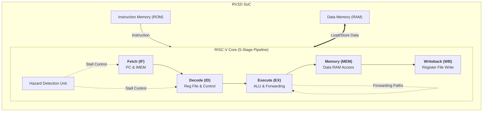

# 5-Stage Pipelined RISC-V RV32I SoC

A custom, synthesizable 5-stage pipelined RV32I System-on-Chip (SoC) designed from scratch in VHDL. This project implements a core subset of the RISC-V integer instruction set architecture (RV32I) complete with full hardware hazard detection, data forwarding logic, instruction/data memories, and an automated Python-driven verification environment using Cocotb.

---

## 🏛️ Architecture & Datapath

The processor follows a classic RISC-V 5-stage pipelined architecture. Data hazards (Read-After-Write) are automatically resolved via a dedicated **Forwarding Unit** that bypasses execution results directly back to the ALU inputs, minimizing pipeline stalls.



## 🚀 Key Features

- **5-Stage Pipeline:** Separate Fetch (IF), Decode (ID), Execute (EX), Memory (MEM), and Writeback (WB) stages.
- **Forwarding & Hazard Control:** Implements data forwarding (`fwd_a`, `fwd_b`) to resolve read-after-write (RAW) data hazards and reduce pipeline stalls.
- **RV32I Instruction Support:** Supports core arithmetic, logical, load/store, and branching instructions.
- **Automated Verification:** Uses Cocotb and Python to generate test stimuli and verify processor behavior through GHDL simulation.
- **Waveform Analysis:** Supports GTKWave for inspecting internal signals, pipeline execution, and data forwarding.

## 🛠️ Tech Stack

| Component | Technology |
|---|---|
| Hardware Description Language | VHDL |
| Simulation Engine | GHDL v5.0.1 |
| Verification Framework | Cocotb |
| Programming Language | Python |
| Waveform Viewer | GTKWave |
| Development Environment | WSL2 / Ubuntu Linux on Windows |

## 📂 Project Structure

```text
riscv-processor-soc/
├── rtl/
│   ├── riscv_soc.vhd              # Top-level SoC wrapper
│   ├── riscv_core.vhd             # Processor core
│   ├── alu.vhd                    # 32-bit arithmetic logic unit
│   ├── register_file.vhd          # 32 x 32-bit register file
│   ├── control_unit.vhd           # Instruction decoder and control logic
│   ├── imm_gen.vhd                # Immediate generation unit
│   ├── pipeline_regs.vhd          # Pipeline registers
│   ├── mem_wb_reg.vhd             # MEM/WB pipeline register
│   ├── forwarding_unit.vhd        # Data forwarding logic
│   ├── hazard_detection_unit.vhd  # Pipeline hazard detection
│   ├── instruction_memory.vhd     # Instruction memory
│   └── data_memory.vhd            # Data memory
├── simulation/
│   ├── test_riscv_soc.py          # Cocotb testbench
│   └── Makefile                   # Simulation automation
└── docs/
    ├── test_execution_log.png     # Automated test execution log
    └── simulation_waveform.png    # GTKWave simulation waveform
