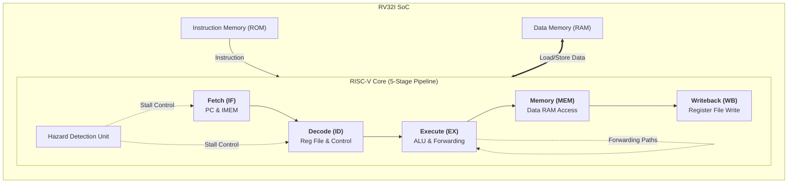

# 5-Stage Pipelined RISC-V RV32I SoC

A custom, synthesizable 5-stage pipelined RV32I System-on-Chip (SoC) designed from scratch in VHDL. This project implements a core subset of the RISC-V integer instruction set architecture (RV32I) complete with full hardware hazard detection, data forwarding logic, instruction/data memories, and an automated Python-driven verification environment using Cocotb.

---

## 🏛️ Architecture & Datapath

The processor follows a classic RISC-V 5-stage pipelined architecture. Data hazards (Read-After-Write) are automatically resolved via a dedicated **Forwarding Unit** that bypasses execution results directly back to the ALU inputs, minimizing pipeline stalls.


## 🚀 Key Features

- **5-Stage Pipeline:** Cleanly separated Fetch (IF), Decode (ID), Execute (EX), Memory (MEM), and Writeback (WB) pipeline stages.
- **Forwarding & Hazard Control:** Implements data forwarding (`fwd_a`, `fwd_b`) to resolve read-after-write (RAW) data hazards and reduce pipeline stalls.
- **RV32I Instruction Support:** Supports core arithmetic, logical, load/store, and branching instructions.
- **Automated Verification:** Uses Cocotb and Python to generate test stimuli and verify processor behavior through GHDL simulation.
- **Waveform Analysis:** Supports GTKWave for inspecting internal signals, pipeline execution, and data forwarding.

## 🛠️ Tech Stack

| Component | Technology |
|---|---|
| Hardware Description Language | VHDL (`std_logic_1164`, `numeric_std`) |
| Simulation Engine | GHDL v5.0.1 |
| Verification Framework | Cocotb |
| Programming Language | Python |
| Waveform Viewer | GTKWave |
| Development Environment | WSL2 / Ubuntu Linux on Windows |

## 📂 Project Structure

```text
riscv-processor-soc/
├── firmware/
│   └── main.c                 # C source / test program
├── rtl/
│   ├── alu.vhd                # 32-bit Arithmetic Logic Unit
│   ├── control_unit.vhd       # Instruction decoder and control unit
│   ├── data_memory.vhd        # Data RAM block
│   ├── forwarding_unit.vhd    # Pipeline data forwarding logic
│   ├── hazard_detection_unit.vhd # Pipeline stall logic
│   ├── imm_gen.vhd            # Immediate generation unit
│   ├── instruction_memory.vhd # Program ROM block
│   ├── mem_wb_reg.vhd         # Memory-to-Writeback pipeline register
│   ├── pipeline_regs.vhd      # Pipeline registers (IF/ID, ID/EX, EX/MEM)
│   ├── register_file.vhd      # 32 x 32-bit register file
│   ├── riscv_core.vhd         # Processor core integrating datapath
│   └── riscv_soc.vhd          # Top-level SoC wrapper
├── screenshots/
│   ├── test_execution_log.png # Automated Python verification terminal log
│   └── simulation_waveform.png # GTKWave internal bus and forwarding trace
├── simulation/
│   ├── __pycache__/
│   │     └── test_riscv_soc.cpython-314-pytest-9.1.1.pyc
│   ├── sim_build/
│   │     └──work-obj93.cf
│   ├── Makefile                   # Automation script for GHDL & Cocotb
│   ├── test_riscv_soc.py          # Python Cocotb testbench
│   ├── results.xml                # Cocotb XML test results output
│   └── riscv_soc.ghw              # Generated GHDL waveform file
```
## 📊 Verification & Simulation Results

### 1. Automated Cocotb Test Execution Log

The testbench boots the SoC, tracks program counter execution cycle-by-cycle, and validates data memory transactions with an automated test status log.

### 2. GTKWave Simulation Waveform

The waveform capture below demonstrates sequential instruction fetching (`pc_val`), active ALU calculations, and dynamic forwarding control (`fwd_a`, `fwd_b`) bypassing pipeline data dependencies.

## ⚙️ Getting Started & Running Simulations

### 1. Install Prerequisites (Linux / WSL2)

Install the required simulation tools and Python dependencies:

```bash
sudo apt update && sudo apt install -y ghdl gtkwave python3 python3-pip
pip install cocotb
```

### 2. Execute Simulation

Navigate to the simulation folder and run the Makefile:

```bash
cd simulation
make
```

### 3. Inspect Waveforms

Open the generated simulation waveform in GTKWave:

```bash
gtkwave riscv_soc.ghw
```

